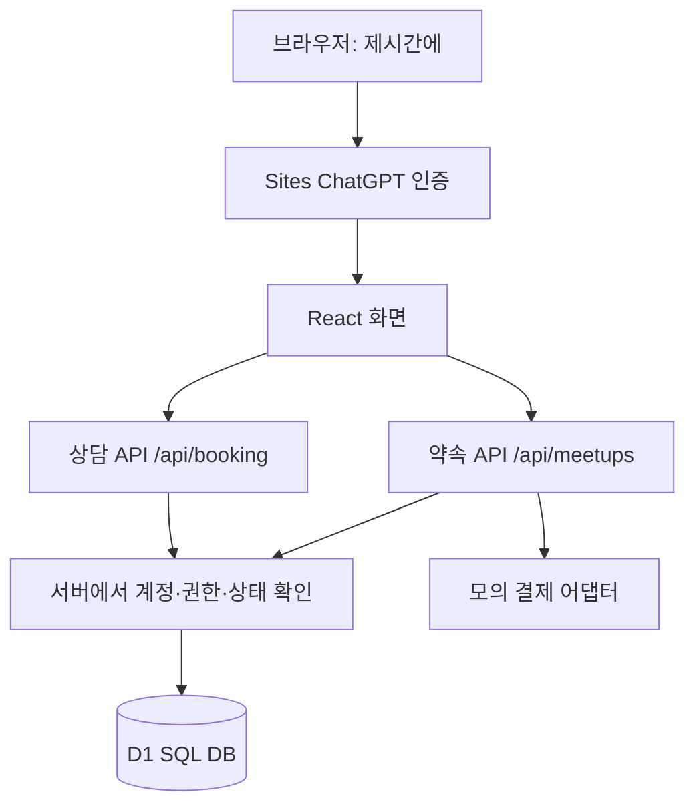
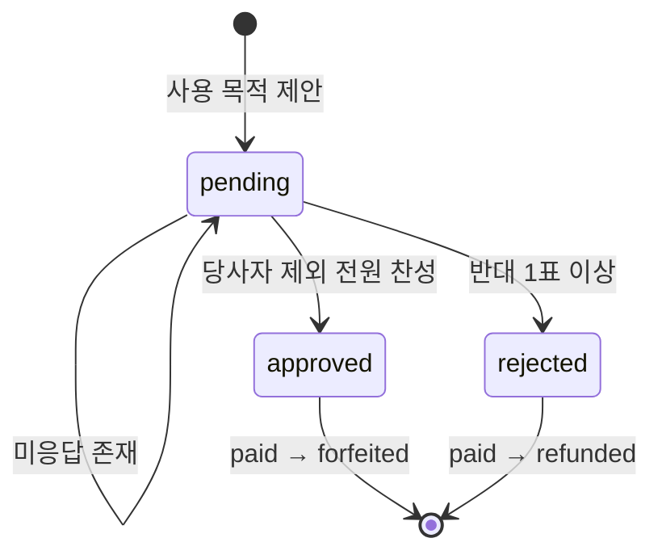

# 제시간에 · 구조와 설계 결정

## 전체 구조

계정 ID는 인증 게이트웨이가 검증해 전달하는 헤더에서 읽습니다. 브라우저가 요청 본문에 적은 사용자 ID를 신뢰하지 않습니다.
표시 이름과 이메일은 계정의 표시 정보이며, 소유권과 투표 자격은 사이트별 사용자 ID로 확인합니다.

## 결정 1. 예약·대기열을 하나로 다룬다

상담 서비스는 정원 1명인 고정 시간대입니다. entries의 active=1 중 ID가 가장 작은 신청을 예약자로 정의합니다.
DB가 부여하는 ID는 같은 시간에 접수되는 신청을 정렬할 수 있습니다. 첫 신청을 취소하면 다음 유효 ID가 예약자가 됩니다.
같은 회원·같은 시간대의 유효 신청은 부분 UNIQUE 인덱스로 제한합니다.
접수 여부와 미래 시간은 INSERT ... SELECT 조건에서 확인하므로 확인과 저장 사이의 경쟁을 줄입니다.

## 결정 2. 약속 확정 시 참여자를 고정한다

예약금을 모두 낸 2명 이상이 있어야 모임장이 시작 전에 확정할 수 있습니다.
확정 후 참여자 추가를 금지해 투표 자격과 분모가 변하지 않도록 했습니다.
한 약속에 한 회원은 한 번만 참여할 수 있습니다.

## 결정 3. 전원 동의는 누락된 찬성 표가 없는 상태다

당사자를 제외한 참여자가 1명 이상이어야 합니다.
각 참여자에게 찬성 표가 있는지 확인하고, 한 명이라도 표가 없으면 보류합니다.
제안자도 직접 투표하며 당사자의 표는 받아들이지 않습니다.
투표 저장, 승인/반대 판정, 모의 예치 상태 전환은 D1 atomic batch 안에서 함께 실행됩니다.

회원별 표와 대상별 제안에는 UNIQUE 제약이 있습니다. 표는 한 번 기록하면 변경하지 않습니다.
완료된 제안은 다시 승인하거나 반대로 뒤집지 않습니다.

## 결정 4. 잔액 확인과 사용 기록을 한 SQL에서 처리한다

가상 모임비 총액 = forfeited 참여자 수 × 약속방에 고정된 1인 예약금.
가용 잔액 = 가상 모임비 총액 − expenses 합계.
INSERT ... SELECT의 WHERE에서 가용 잔액을 확인합니다. 원자적인 쓰기 순서에서 검사하므로 동시에 여러 지출 요청이 와도 초과 사용을 허용하지 않습니다.
모임장만 기록할 수 있으며 모든 참여자가 사용 내역을 볼 수 있습니다.

## 결정 5. 모의 결제와 실제 결제를 명확히 분리한다

현재 어댑터는 mock_ 접두어의 영수증 참조만 만듭니다. 외부 결제 API는 호출하지 않습니다.
결제수단을 클릭했다고 실제 돈이 승인되었다고 판단하지 않습니다.
실결제를 도입할 때는 승인 응답과 웹훅 검증, 금액·주문 매칭, 멱등성, 취소·환불 실패 처리와 대사 기록을 추가해야 합니다.
지금의 가상 장부가 실제 예치·보관·지급을 수행한다고 해석해서는 안 됩니다.

## 결정 6. 전체를 먼저 완성하고 역으로 공부한다

홈 → 약속 상세 → 버튼의 act → API action → SQL → DB 제약 → 통합 테스트 순서로 읽을 수 있게 파일과 문서를 구성했습니다.
서로 다른 기능은 API와 테이블로 구분하고, 샘플 체험은 서버 데이터와 분리해 혼자 전체 흐름을 살펴볼 수 있도록 했습니다.
